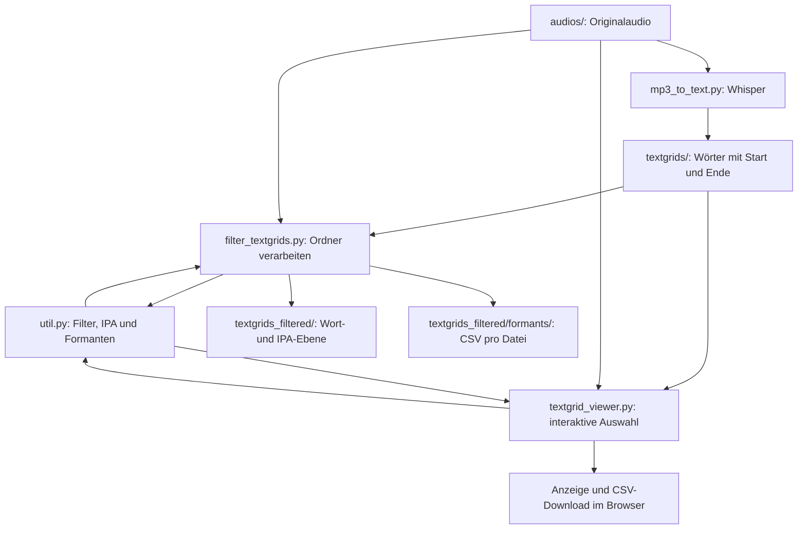

# Audio → TextGrid → IPA und Formanten

Dieses Projekt transkribiert Audiodateien mit Whisper, speichert Wortzeitintervalle als Praat-TextGrids und analysiert ausgewählte Wörter. Die Analyse lässt sich für einen ganzen Ordner oder interaktiv in Streamlit ausführen.

**Die Formanten werden derzeit in der Wortmitte gemessen.** Die TextGrids enthalten Wortgrenzen, keine Vokalgrenzen. Die Messung ist deshalb eine Näherung und kann auch auf einen Konsonanten fallen. Die IPA-Aussprache stammt aus einem englischen Wörterbuch; sie wird nicht aus der tatsächlichen Aussprache im Audio erkannt.

## 1. Installation und erster Durchlauf

Die Befehle im Projektordner ausführen:

```bash
python -m pip install -r requirements-viewer.txt
python -m pip install openai-whisper
```

`openai-whisper` wird nur für die Erstellung neuer Transkriptionen benötigt. Zusätzlich müssen `ffmpeg` und `ffprobe` im PATH verfügbar sein. Unter Ubuntu/Debian:

```bash
sudo apt install ffmpeg
```

Der Ablauf für neue Daten:

1. MP3-Dateien in `audios/` ablegen.
2. `python mp3_to_text.py` ausführen. Dadurch entstehen die ursprünglichen TextGrids in `textgrids/`.
3. Am Anfang von `filter_textgrids.py` die gewünschten Vokale einstellen.
4. `python filter_textgrids.py` ausführen. Dadurch entstehen gefilterte TextGrids und Formanten-CSV-Dateien.
5. Optional mit `python -m streamlit run textgrid_viewer.py` einzelne Dateien ansehen und interaktiv analysieren.

Bereits vorhandene TextGrids können direkt ab Schritt 3 verwendet werden, wenn passende Audiodateien vorliegen.

## 2. Dateien und Datenfluss



Beispiel für eine Datei namens `aufnahme.mp3`:

```text
praatan/
├── audios/
│   └── aufnahme.mp3
├── textgrids/
│   └── aufnahme
├── textgrids_filtered/
│   ├── aufnahme
│   └── formants/
│       └── aufnahme_formanten.csv
├── mp3_to_text.py
├── filter_textgrids.py
├── textgrid_viewer.py
└── util.py
```

TextGrids aus `mp3_to_text.py` haben absichtlich keine Dateiendung. App und Analyseskript akzeptieren auch `.TextGrid`. Die Audiozuordnung erfolgt über den gemeinsamen Namen: `aufnahme` beziehungsweise `aufnahme.TextGrid` gehört zu `aufnahme.mp3`.

| Programm              | Eingabe                                                                | Ausgabe                                         | Standardfilter          |
| --------------------- | ---------------------------------------------------------------------- | ----------------------------------------------- | ----------------------- |
| `mp3_to_text.py`      | MP3-Dateien                                                            | Ursprüngliche TextGrids                         | Kein Wortfilter         |
| `filter_textgrids.py` | TextGrids und zugehöriges Audio                                        | Gefilterte TextGrids und CSV-Dateien            | Exakte IPA-Vokale       |
| `textgrid_viewer.py`  | Ein TextGrid mit Audio                                                 | Interaktive Anzeige und CSV-Download            | Geschriebene Buchstaben |
| `util.py`             | Wörter, Zeitintervalle und Audiosamples aus den aufrufenden Programmen | Filterergebnisse, IPA, Messzeilen und CSV-Bytes | Vom Aufrufer vorgegeben |

**Für vergleichbare Ergebnisse müssen App und Skript denselben Filtermodus, dieselbe Wortebene und dieselben Analyseparameter verwenden.** Die Zeichenfolge `a, i, u, ae` allein reicht dafür nicht aus.

## 3. `mp3_to_text.py`: Audio transkribieren

```bash
python mp3_to_text.py --audio-dir audios --output-dir textgrids --model small --language en
```

Schritt für Schritt:

1. **Dateien suchen:** Das Skript sucht direkt im Eingabeordner nach `*.mp3` und verarbeitet die Treffer alphabetisch. Unterordner werden nicht durchsucht.
2. **Whisper laden:** Das Modell wird einmal für den gesamten Lauf geladen. Standard ist `small`. Fehlende Modelldaten werden bei Bedarf heruntergeladen. Das verwendete Rechengerät wird im Terminal angezeigt.
3. **Audiodauer bestimmen:** `audio_duration()` ruft `ffprobe` auf. Die Dauer legt das Ende der späteren TextGrid-Zeitachse fest.
4. **Sprache transkribieren:** Whisper erhält die Audiodatei mit `word_timestamps=True` und standardmäßig der Sprache `en`. Es erzeugt Textabschnitte und darin Wortinformationen mit Start- und Endzeiten. Erkannte Abschnitte erscheinen im Terminal.
5. **Intervalle aufbereiten:** `words_from_result()` entfernt äußere Leerzeichen. Es übernimmt nicht leere Wörter, deren Ende nach dem Start liegt. Wenn ein Abschnitt keine Wortzeitstempel enthält, wird stattdessen sein gesamter Text mit den Abschnittsgrenzen übernommen. Solche Mehrwortintervalle sind später nicht als einzelne Wörter auswertbar.
6. **TextGrid aufbauen:** `write_textgrid()` begrenzt Zeitwerte auf die Audiodauer und ergänzt leere Intervalle in den zeitlichen Lücken. Diese Lücken bedeuten „ohne Beschriftung“; sie sind keine separate akustische Stille-Erkennung. Anführungszeichen in Texten werden für das TextGrid-Format maskiert.
7. **Datei speichern:** Es entsteht ein TextGrid im langen Textformat, UTF-8, mit der Intervallebene `Word`. Der Dateiname entspricht der MP3 ohne `.mp3`.

Vorhandene gleichnamige Ausgaben werden mit einer Terminalwarnung überschrieben. Bei einem Fehler bricht dieser Transkriptionslauf ab; bereits geschriebene Dateien bleiben erhalten. Während längerer Schritte erscheint alle 15 Sekunden eine Statusmeldung.

Die Standardordner dieses Skripts sind relativ zum aktuellen Arbeitsverzeichnis. `--language de` ist für eine deutsche Whisper-Transkription möglich; die nachfolgende IPA-Funktion dieses Projekts verwendet jedoch weiterhin ein englisches Wörterbuch.

## 4. `util.py`: Gemeinsame Verarbeitung

`util.py` wird von App und Analyseskript importiert und nicht als eigenes Kommando gestartet.

### Schritt 1: Filter normalisieren — `parse_filters()`

Die kommagetrennte Eingabe wird zerlegt, von äußeren Leerzeichen befreit und kleingeschrieben. Doppelte Einträge werden entfernt. Eine leere Liste liefert keine Treffer.

| Modus     | Auswahlregel                                                                                                            | Beispiel                                                                                   |
| --------- | ----------------------------------------------------------------------------------------------------------------------- | ------------------------------------------------------------------------------------------ |
| `letters` | Mindestens eine eingegebene Buchstabenfolge muss im geschriebenen Wort vorkommen. Groß-/Kleinschreibung wird ignoriert. | `a` findet `cat`; `ae` bedeutet die geschriebene Folge `ae`.                               |
| `ipa`     | Mindestens ein vollständiges IPA-Vokaltoken muss passen. `ae` wird zu `æ`.                                              | `ae` findet den Vokal in `cat` → `kæt`. `i` findet `see` → `si`, aber nicht `sit` → `sɪt`. |

Diphthonge werden als ganze Tokens behandelt: `a` findet nicht `aɪ` oder `aʊ`; `i` findet nicht `ɪ`. Auch `a` und `ɑ` sind verschiedene Symbole. Für diese Laute ausdrücklich `aɪ`, `aʊ`, `ɪ` beziehungsweise `ɑ` eingeben.

### Schritt 2: Wörter prüfen und zählen — `filter_words()`

1. Aus den Beschriftungen werden Wörter erkannt. Buchstaben und innere Apostrophe wie in `don't` gehören zum Wort; äußere Satzzeichen gehören nicht zur Suchform. Die originale Beschriftung bleibt für Anzeige und Ausgabe erhalten.
2. Gezählt werden **Wortvorkommen**, nicht verschiedene Wörter. Wiederholungen zählen mehrfach; leere Intervalle zählen nicht.
3. Nur Intervalle mit genau einem erkannten Wort und gültigen, endlichen Start-/Endzeiten werden weiterverarbeitet. Das Ende muss nach dem Start liegen. Mehrwortintervalle werden nicht künstlich in kleinere Zeitintervalle aufgeteilt.
4. Im Buchstabenmodus wird zuerst nach der Schreibweise gefiltert. Nur Treffer gehen zur IPA-Umwandlung.
5. Im IPA-Modus wird zuerst die Aussprache bestimmt und anschließend nach den gewählten Vokaltokens gefiltert.
6. Nur Treffer mit verwendbarer IPA-Aussprache und mindestens einem erkannten Vokal gelangen in die Ergebnisliste. Unbekannte Wörter werden separat zurückgegeben.

Die Zähler bedeuten:

| Zähler             | Bedeutung                                                                                                                                  |
| ------------------ | ------------------------------------------------------------------------------------------------------------------------------------------ |
| Insgesamt          | Alle erkannten Wortvorkommen in der gewählten ursprünglichen Ebene, auch in später ausgeschlossenen Mehrwortintervallen                    |
| Filtertreffer      | Im Buchstabenmodus passende gültige Einzelwortintervalle, auch wenn ihre IPA-Aussprache fehlt; im IPA-Modus Wörter mit passendem IPA-Vokal |
| Mit IPA auswertbar | Tatsächlich übernommene Wörter für Anzeige und Messung                                                                                     |

### Schritt 3: Englische IPA-Aussprache — `english_ipa()`

`eng_to_ipa` schlägt das Wort im CMU-Wörterbuch nach. Die Umwandlung verwendet eine US-englische Wörterbuchaussprache und eine der verfügbaren Aussprachevarianten. Sie untersucht das Audio nicht und löst Aussprachevarianten nicht anhand des Satzkontexts auf.

Nicht gefundene Wörter markiert die Bibliothek mit `*`. Die Funktion behandelt diese als unbekannt; der Worttext wird nicht ersatzweise als IPA verwendet. Wiederholte Abfragen desselben Funktionsarguments werden zwischengespeichert.

Für jeden übernommenen Eintrag entsteht ein `Word` mit:

- `start`, `end`: ursprüngliche Zeitgrenzen in Sekunden;
- `label`: ursprüngliche Wortbeschriftung;
- `ipa`: IPA-Aussprache des ganzen Wortes;
- `vowels`: alle erkannten Vokale im Buchstabenmodus, nur die passenden Vokale im IPA-Modus;
- `context`: Zielbeschriftung in eckigen Klammern mit benachbarten worttragenden Beschriftungen aus der ursprünglichen Ebene.

Der Kontext wird vor dem Herausnehmen nicht passender Wörter bestimmt. Er kann daher auch Wörter enthalten, die selbst nicht durch den Filter kommen.

### Schritt 4: Audio vorbereiten — `load_audio()`

Das Ordnerskript dekodiert die zugehörige Audiodatei mit FFmpeg nach Mono, 22.050 Hz und vorzeichenbehafteten 16-Bit-Samples. Daraus entsteht ein eindimensionales NumPy-Array. Die Streamlit-Funktion `decode_audio()` erzeugt dasselbe Audioformat aus den eingelesenen Dateibytes. Die Originaldatei wird nicht verändert.

### Schritt 5: Formanten messen — `calculate_formants()`

1. Abtastrate, Analyseparameter und das Mono-Signal werden geprüft. Ganzzahlige Samples werden in Gleitkomma-Amplituden umgerechnet; ungültige Zahlen im Signal führen zu einem Fehler.
2. Parselmouth erstellt ein Praat-Soundobjekt aus dem vollständigen dekodierten Signal.
3. Die Burg-Analyse berechnet Formantenschätzungen entlang der gesamten Aufnahme. Die Auswahl der Wörter begrenzt die exportierten Messpunkte, nicht das eingelesene Audiosignal.
4. Für jedes übernommene Wort wird `t = (start + end) / 2` berechnet.
5. F1, F2, F3 und F4 werden an diesem Zeitpunkt mit `get_value_at_time()` abgefragt. Die Werte werden in Hertz auf zwei Nachkommastellen gerundet.
6. Pro Wort entsteht genau eine Tabellenzeile. Auch bei mehreren passenden Vokalen werden keine zusätzlichen Vokalzeitpunkte erzeugt.

Standardparameter:

| Parameter                            | Wert                       |
| ------------------------------------ | -------------------------- |
| Formantenobergrenze                  | 5500 Hz                    |
| Maximale Anzahl für die Burg-Analyse | 5; exportiert werden F1–F4 |
| Abstand der Analyseframes            | 0,01 s                     |
| Effektive Fensterlänge               | 0,025 s                    |
| Präemphase ab                        | 50 Hz                      |

Liegt ein Wortintervall außerhalb des Audios oder seine Mitte außerhalb der verfügbaren Analyseframe-Zentren, bleiben seine Formanten leer. Das gilt auch bei zu kurzem Audio oder nicht verfügbaren Schätzungen. Nicht endliche oder nicht positive Werte werden nicht als Messwerte übernommen. Es wird kein fehlender Wert durch `0` ersetzt.

Die Formantenobergrenze muss zur Stimme passen. Hintergrundmusik, Geräusche, ungenaue Wortgrenzen und Konsonanten an der Wortmitte können die Resultate verfälschen. Ein numerisch vorhandener Wert ist keine automatische Qualitätsbestätigung.

### Schritt 6: CSV erzeugen — `export_csv()`

Die Messzeilen werden in fester Spaltenreihenfolge als CSV-Bytes ausgegeben: UTF-8 mit BOM, Komma als Trennzeichen und Dezimalpunkt. Fehlende Werte bleiben leere Felder. Eine leere Ergebnisliste ergibt nur die Kopfzeile. Die aufrufende Anwendung entscheidet, ob die Bytes auf die Festplatte geschrieben oder zum Download angeboten werden.

## 5. `filter_textgrids.py`: Einen ganzen Ordner analysieren

Am Anfang des Skripts stehen die Einstellungen:

```python
VOWELS = ('a', 'i', 'u', 'ae')
FILTER_MODE = 'ipa'
MAXIMUM_FORMANT = 5500.0
TIME_STEP = 0.01
WINDOW_LENGTH = 0.025
```

Start:

```bash
python filter_textgrids.py
```

Schritt für Schritt:

1. **Ordner und Filter prüfen:** Standardmäßig werden `textgrids/`, `audios/` und `textgrids_filtered/` neben dem Skript verwendet. Der Ausgabeordner darf nicht der Eingabeordner sein oder diesen enthalten.
2. **TextGrids sammeln:** Die Dateien direkt im Eingabeordner werden alphabetisch verarbeitet. Berücksichtigt werden `.TextGrid`, Dateien ohne Endung und weitere Dateien, deren Header `"TextGrid"` enthält. Versteckte Dateien und Unterordner werden ausgelassen. Ein nicht lesbares TextGrid wird als Fehler gemeldet.
3. **Vorhandene Ausgaben prüfen:** Existiert schon das gefilterte TextGrid **oder** seine CSV, wird diese Datei ohne `--overwrite` vollständig übersprungen. Geänderte Vokale allein lösen keine Neuberechnung vorhandener Ausgaben aus.
4. **Audio zuordnen:** `matching_audio()` verlangt genau eine gleichnamige Datei im Audioordner. Unterstützte Endungen sind `.mp3`, `.wav`, `.flac`, `.ogg`, `.m4a` und `.aac`. Kein Treffer oder mehrere Treffer führen zu einem Fehler für diese Datei.
5. **TextGrid einlesen:** Praatio liest Intervalle inklusive leerer Beschriftungen. Die Wortebene wird mit `--tier` vorgegeben oder automatisch gewählt: bevorzugt `Word`, `Words` oder `Wörter` ohne Beachtung der Groß-/Kleinschreibung, sonst die erste Intervallebene. Punktebenen werden nicht analysiert.
6. **Filtern und IPA bestimmen:** `filter_file()` ruft die gemeinsamen Funktionen aus `util.py` auf. Wortzahlen und ausgeschlossene Wörter werden protokolliert.
7. **Gefiltertes TextGrid vorbereiten:** In einem temporären Ordner entstehen die gefilterte Wortebene und eine zusätzliche Ebene `<Wortebene> · IPA`. Die Zeitpositionen der Treffer und die gesamte Zeitachse bleiben erhalten. Ausgeschlossene Bereiche werden leer; weitere ursprüngliche Ebenen werden nicht übernommen.
8. **Audio und Formanten berechnen:** Bei vorhandenen Treffern wird das Audio geladen und F1–F4 für diese Wörter berechnet. Ohne Treffer wird die Dekodierung übersprungen; die eindeutige Audiozuordnung wird trotzdem verlangt.
9. **CSV vorbereiten:** `export_csv()` erstellt die Tabelle. Ohne Treffer enthält sie nur den Spaltenkopf.
10. **Ergebnisse ablegen:** Nach erfolgreicher Berechnung werden das TextGrid nach `textgrids_filtered/<TextGrid-Dateiname>` und die CSV nach `textgrids_filtered/formants/<TextGrid-Dateiname>_formanten.csv` verschoben. Bei einem Eingabenamen mit `.TextGrid` bleibt diese Endung auch im CSV-Basisnamen enthalten.
11. **Zusammenfassung ausgeben:** Das Terminal meldet Messzeilen, fehlende Formanten und die Gesamtzahlen der neu verarbeiteten Dateien. Nach einem Dateifehler werden weitere Dateien versucht. Bei mindestens einem Fehler ist der Exitcode `1`, sonst `0`; Benutzerabbruch liefert `130`.

Das Skript verwendet die vorhandene Texttranskription. Es startet keinen weiteren Whisper-Lauf. Originalaudio und ursprüngliche TextGrids bleiben unverändert.

Weitere Aufrufe:

```bash
# Vokalauswahl für diesen Lauf überschreiben
python filter_textgrids.py --mode ipa --filter 'æ, i, u, ɑ, aɪ'

# Nach geschriebenen Buchstaben filtern
python filter_textgrids.py --mode letters --filter 'a, u'

# Andere Ordner und Wortebene
python filter_textgrids.py --input-dir textgrids --audio-dir audios --output-dir filtered_custom --tier Word

# Neu berechnen; auch nötig, wenn bisher nur das gefilterte TextGrid existiert
python filter_textgrids.py --overwrite
```

## 6. `textgrid_viewer.py`: Interaktiv ansehen und auswerten

```bash
python -m streamlit run textgrid_viewer.py
```

Die Oberfläche ist standardmäßig unter `http://localhost:8501` erreichbar.

Schritt für Schritt:

1. **Dateien auswählen:** In der Seitenleiste ein TextGrid aus dem Projektordner auswählen oder TextGrid und Audio hochladen. Bei Projektdateien wird gleichnamiges Audio vorausgewählt; die Zuordnung lässt sich manuell ändern. Bei abweichenden Namen erscheint ein Hinweis.
2. **Daten laden:** `read_grid()` liest das lange oder kurze TextGrid-Textformat, einschließlich UTF-8/UTF-16. `decode_audio()` erzeugt das Mono-Signal mit 22.050 Hz. Beide Ergebnisse werden begrenzt zwischengespeichert, damit Bedienaktionen nicht jedes Mal neu dekodieren müssen.
3. **Zeitbereiche prüfen:** Die App vergleicht TextGrid-Zeitbereich und Audiodauer. Bei Abweichungen zeigt sie einen Hinweis, verschiebt die Annotationen aber nicht automatisch.
4. **Wortebene und Filter wählen:** Die Wortebene wird wie beim Ordnerskript vorausgewählt. Standard ist hier **Geschriebene Buchstaben**, Eingabe `a, i, u, ae`. Für dieselbe Auswahl wie im Standardskript auf **Exakte IPA-Vokale** wechseln.
5. **Gefilterte Daten anzeigen:** `word_analysis()` ruft `filter_words()` auf. Die drei Zähler beziehen sich auf die gesamte gewählte Ebene. Die IPA-Tabelle und die Diagramme enthalten anschließend nur auswertbare Filtertreffer. Bei fehlenden Treffern endet die Anzeige mit einem Hinweis.
6. **Wellenform darstellen:** `waveform()` fasst den sichtbaren Ausschnitt in Blöcke zusammen und zeichnet deren Minimum und Maximum. So bleiben kurze Spitzen beim Herauszoomen sichtbar. Diese Reduktion betrifft nur die Grafik; die Formantenberechnung verwendet die vollständigen dekodierten Samples.
7. **Zeitachse und Wiedergabe bedienen:** „Ansicht von/bis“ legt den Ausschnitt fest. Ziehen im Diagramm zoomt nur die Grafik. Textsuche und Intervallauswahl dienen der Navigation und verändern den Analysefilter nicht. Ein Annotationsklick wählt ein Intervall für die Wiedergabe. `audio_clip()` erzeugt daraus einen WAV-Ausschnitt; der Player beginnt relativ zum Ausschnitt bei `0`, die Diagrammachse bleibt auf der Originalzeit.
8. **Formanten berechnen:** Die Schaltfläche „F1–F4 für alle gefilterten Wörter berechnen“ ruft dieselbe `calculate_formants()`-Funktion wie das Ordnerskript auf. Berechnet werden alle Filtertreffer der Datei, unabhängig vom sichtbaren Ausschnitt. Obergrenze, Analyseschritt und Fensterlänge sind einstellbar.
9. **Tabelle exportieren:** Die App zeigt die Messzeilen und bietet `<Audio-Dateiname ohne Endung>_formanten.csv` zum Browserdownload an. Sie schreibt nicht automatisch nach `textgrids_filtered/formants/`. Geänderte Dateien, Filter, Wortebenen oder Parameter blenden nicht passende Resultate aus; gecachte Berechnungen können bei erneutem Aufruf wiederverwendet werden.

Die Oberfläche bearbeitet keine Annotationen und speichert keine gefilterten TextGrids. Es gibt keinen mitlaufenden Abspielcursor. Für eine vollständige Neuauswahl und ursprünglichen Wortkontext die Dateien aus `textgrids/` verwenden: Ein bereits gefiltertes TextGrid enthält die ausgeschlossenen Wörter nicht mehr als beschriftete Intervalle.

## 7. Die Formanten-CSV lesen

App und Ordnerskript verwenden dieselben Spalten:

| Spalte                 | Inhalt                                                                                                                        |
| ---------------------- | ----------------------------------------------------------------------------------------------------------------------------- |
| `datei`                | Name der zugehörigen Audiodatei inklusive Endung                                                                              |
| `vowel`                | Durch Leerzeichen getrennte IPA-Vokale; im IPA-Modus nur passende Vokale, im Buchstabenmodus alle erkannten Vokale des Wortes |
| `frame`                | Messzeitpunkt in Sekunden ab Audiobeginn: `(start + end) / 2`. Kein fortlaufender Frame-Index.                                |
| `wordcontext`          | Zielbeschriftung in `[Klammern]` mit benachbarten worttragenden Beschriftungen                                                |
| `F1`, `F2`, `F3`, `F4` | Formantenfrequenzen in Hz; nicht verfügbare Werte bleiben leer                                                                |

Beispiel für die Zeitberechnung: Ein Wortintervall von `1.20` bis `1.60` Sekunden ergibt `frame = 1.40`. Enthält das Wort zwei passende Vokale, stehen beide im Feld `vowel`; es bleibt eine gemeinsame Messung bei `1.40` Sekunden. Daraus dürfen keine getrennten Messungen der beiden Vokale abgeleitet werden.

## 8. Tests und technische Referenzen

```bash
python -m unittest discover -s tests -v
```

Die Tests prüfen unter anderem Filtermodi, IPA-Zuordnung, Zeitgrenzen, CSV-Spalten, fehlende Messwerte, Audioausschnitte und die Verarbeitung mehrerer Dateien einschließlich Fehlerfällen.

- [Streamlit: Diagrammauswahl](https://docs.streamlit.io/develop/api-reference/charts/st.plotly_chart)
- [Praatio: TextGrid lesen und schreiben](https://timmahrt.github.io/praatIO/praatio/textgrid.html)
- [English-to-IPA: Wörterbuchtranskription](https://github.com/mphilli/English-to-IPA)
- [Praat: Burg-Formantenanalyse](https://www.fon.hum.uva.nl/praat/manual/Sound__To_Formant__burg____.html)
- [Parselmouth: Python-Schnittstelle zu Praat](https://parselmouth.readthedocs.io/en/stable/api_reference.html)
